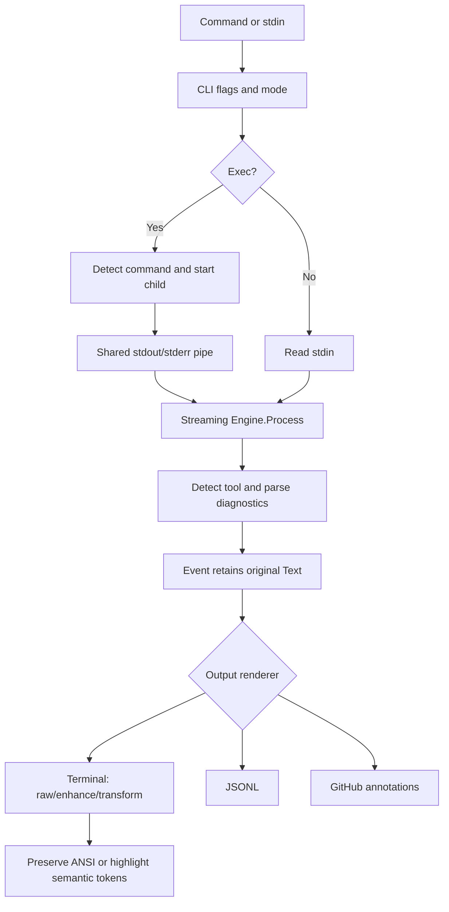

# 🧠 rodlog architecture

A guided tour of the command-to-diagnostic pipeline.



## Follow a log line

1. `cmd/rodlog/main.go` selects stdin or a child process, parses flags, and preserves the child's exit status.
2. `rodlog.go` consumes the stream incrementally and retains original text in every `Event`.
3. `semantic.go` optionally extracts structured diagnostics; unknown lines stay ordinary output.
4. `highlight.go` resolves overlapping severity, code and location spans by priority.
5. `syntax.go` uses Chroma conservatively for recognized source snippets, not arbitrary log lines.
6. `diagnostic_render.go` formats cards, with source excerpts supplied by `diagnostic_frame.go`.
7. `integrations.go` supplies machine-readable JSONL and GitHub Actions annotations.

## Design invariants

- Never discard command output because a renderer failed.
- Preserve exit codes so CI sees the actual command result.
- Avoid adding ANSI to redirected output unless explicitly requested.
- Preserve existing ANSI and keep source text available for downstream tools.
- Prefer semantic severity colors to arbitrary syntax coloring.

## Local validation

```bash
cd packages/rodlog
gofmt -l .
go test -race ./...
go run ./cmd/rodlog --color=always --tool=typescript < testdata/typescript.log
```

See [README](../README.md) for installation and shell hooks.
